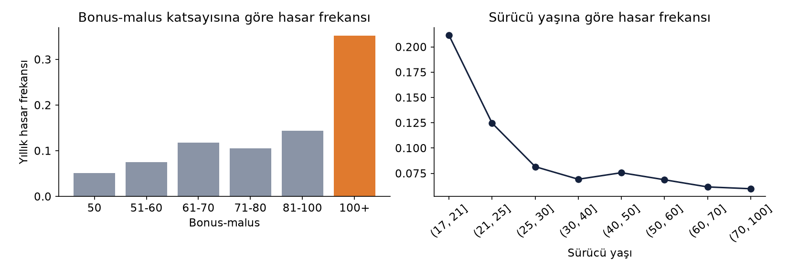
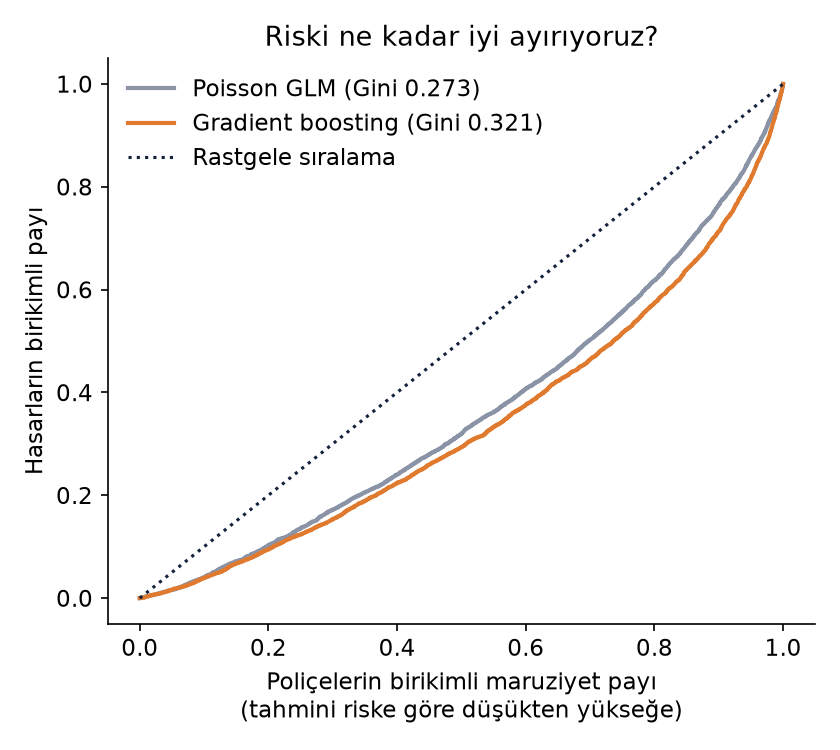
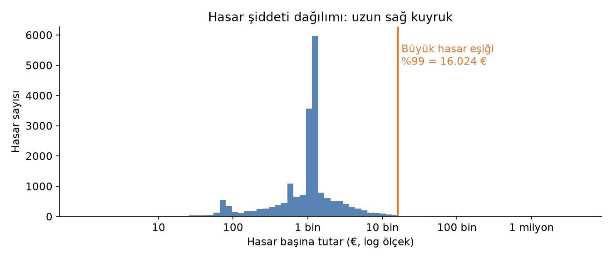
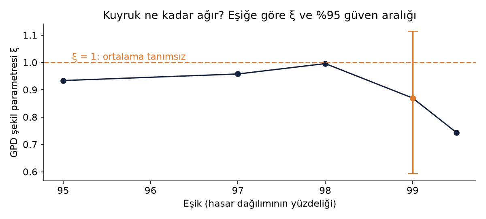
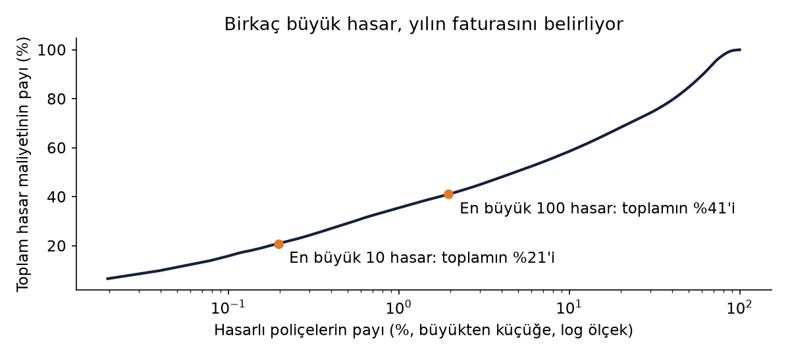
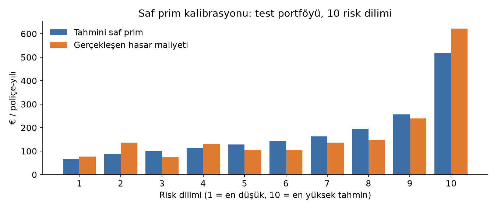

# Bir Yılın Faturasını On Hasar Yazar
*Açık veriyle bir trafik sigortası fiyatlama motoru: frekans, şiddet ve kuyruk riski*

*Mehmet Ali Kaya · Veri Yönetimi Uzmanı, Yönetim Bilişim Sistemleri Doktora Adayı, İstatistik Yüksek Lisans*

**678.013 poliçelik açık bir trafik portföyünde hasar frekansını, hasar şiddetini ve büyük hasarları ayrı ayrı modelledim. Makine öğrenmesi riski daha iyi sıraladı; ama asıl ders, yılın faturasının birkaç büyük hasar tarafından yazılmasıydı.**

## Hasarın iki sorusu

Her sigortacı bir poliçeye bakarken aslında iki ayrı soru sorar: Bu poliçe hasar yapar mı, yaparsa ne kadar tutar? Aktüerya dilinde bunlara frekans ve şiddet diyoruz; saf prim de bu ikisinin çarpımından doğuyor. Kâğıt üzerinde sade bir çarpma işlemi. Sahada ise bu iki sorunun karakteri birbirine hiç benzemiyor: Frekans, kalabalığın davranışını anlatan sakin bir hikâye; şiddet ise ara sıra sahneye çıkıp bütün yılın sonucunu değiştiren birkaç büyük hasarın hikâyesi.

Bu yazıda, herkesin indirip tekrarlayabileceği açık bir veri setiyle bu iki hikâyeyi ayrı ayrı modelledim, sonra yeniden birleştirip bir fiyatlama motoru kurdum. Kodun tamamı, sonuçlar ve modelin kendisi açık; yazının sonunda bağlantıları bulabilirsiniz.

## Veri: 678 bin poliçe, 26 bin hasar

Kullandığım veri, aktüerya eğitiminde sıkça başvurulan freMTPL2: Fransız bir sigortacının trafik (motor third-party liability) portföyü. Veri, Christophe Dutang ve Arthur Charpentier'in CASdatasets koleksiyonunun parçası ve OpenML üzerinde CC0 lisansıyla, yani kısıtsız olarak yayımlanıyor. Temizlik sonrası elimde 678.013 poliçe, toplam 358.360 poliçe-yılı maruziyet ve 26.406 hasar vardı. Portföyün yıllık hasar frekansı yüzde 7,4; yani yaklaşık her 14 poliçe-yılında bir hasar.

Her açık veri setinin bir hikâyesi olduğu gibi kusurları da var ve bunları saklamamak gerekir. Maruziyeti bir yılı aşan 1.224 kaydı bir yılla sınırladım, poliçe başına hasar sayısını 4'te kestim. Daha önemlisi, 9.116 poliçede hasar sayısı görünüyor ama hasar tutarı kaydı yok. Bu tutarsızlık veri setinin bilinen bir özelliği; scikit-learn dokümantasyonundaki yaklaşımla bu poliçeleri hasarsız kabul ettim. Bu tür kararlar sonucu etkiler; o yüzden her birini koda ve yazıya açıkça yazdım.

## Frekans: Kalabalığın davranışı

Önce verinin kendisine bakalım. Bonus-malus katsayısı 100'ün üzerindeki sürücülerin yıllık hasar frekansı, 50'deki (en iyi basamak) sürücülerin yaklaşık 6,9 katı. 18-21 yaş aralığındaki sürücüler ise 40-50 yaş grubuna göre 2,8 kat daha sık hasar yapıyor (Grafik 1). Bu, sektörün sezgisiyle örtüşen ama rakamla görmesi hep öğretici bir tablo.

Frekansı iki yöntemle modelledim: Sektörün iş atı olan Poisson GLM ve bir makine öğrenmesi yöntemi olan Poisson kayıplı gradient boosting. İkisini de verinin yüzde 80'iyle eğittim, hiç görmedikleri yüzde 20'lik bir test portföyünde (135.603 poliçe) ölçtüm. Riski sıralama gücünü gösteren Gini katsayısı GLM'de 0,273, gradient boosting'de 0,321 çıktı (Grafik 2). Açıklanan sapma (D²) ise sırasıyla yüzde 4,1 ve yüzde 6,2.

Bu D² değerleri ilk bakışta düşük görünebilir; ama trafik hasarında beklenen bu. Tek bir sürücünün o yıl kaza yapıp yapmayacağı büyük ölçüde şansa bağlı; modelin işi bireyi tahmin etmek değil, riskleri doğru sıraya dizmek. Gradient boosting bu sıralamayı belirgin biçimde daha iyi yapıyor. Bedeli ise açıklanabilirlik: GLM'in katsayıları tek tek okunabilirken, boosting modelini anlatmak için ek araçlar gerekiyor. Düzenleyicinin ve müşterinin sorduğu "neden bu fiyat?" sorusu, sadece doğruluk kadar önemli.

*Grafik 1. Bonus-malus ve sürücü yaşına göre gözlenen yıllık hasar frekansı.*

*Grafik 2. Test portföyünde Lorenz eğrileri: eğri köşegenden ne kadar uzaksa model riski o kadar iyi sıralıyor.*

## Şiddet: Uzun kuyruğun ağırlığı

Hasar tutarlarına geçince tablo değişiyor. Hasar başına tutarın medyanı 1.172 avro, ortalaması 2.279 avro; ortalamanın medyanın neredeyse iki katı olması, dağılımın sağa doğru upuzun bir kuyruğu olduğunu söylüyor. Veri setindeki en büyük tek hasar 4,07 milyon avro (Grafik 3).

Bu yüzden şiddeti tek bir modelle değil, iki parçada ele aldım. Dağılımın yüzde 99'luk dilimine (16.024 avro) bir eşik koydum. Eşiğin altındaki olağan hasarları Gamma GLM ile, eşiği aşan kısmı ise Uç Değer Teorisi'nin (EVT) Genelleştirilmiş Pareto dağılımıyla modelledim. Eşiği aşan 199 hasara uyan dağılımın şekil parametresi ξ = 0,87 çıktı.

Bu sayı yazının belki de en önemli bulgusu. ξ değeri 1'e yaklaştıkça kuyruk ağırlaşır; 1'in üzerinde ise dağılımın ortalaması bile tanımsız hale gelir. Bootstrap yöntemiyle ξ için hesapladığım yüzde 95 güven aralığı 0,59 ile 1,11 arasında; yeniden örneklemelerin yüzde 20'sinde ξ 1'i aştı. Eşiği değiştirdiğimde de ξ 0,74 ile 1,00 arasında gezindi (Grafik 4). Kısacası bu portföyde büyük hasarın "ortalama maliyeti" diye sağlam bir sayı yok; yalnızca bir aralık var.

Bu belirsizliğin pratikteki karşılığını test portföyünde gördüm: En büyük 10 hasar, test yılının toplam hasar maliyetinin yüzde 21'sini, en büyük 100 hasar ise yüzde 41'ini oluşturuyor (Grafik 5). Bir yılın faturasını, gerçekten de bir avuç hasar yazıyor.

*Grafik 3. Hasar başına tutarın dağılımı (logaritmik ölçek) ve yüzde 99 büyük hasar eşiği.*

*Grafik 4. Eşiğe göre GPD şekil parametresi ξ; turuncu çubuk yüzde 99 eşiğindeki yüzde 95 bootstrap güven aralığı.*

*Grafik 5. Test yılında hasar maliyetinin en büyük hasarlarda yoğunlaşması.*

## Motoru birleştirmek: Saf prim

Fiyatlama motoru üç parçadan oluşuyor: Gradient boosting ile frekans, Gamma GLM ile olağan hasar şiddeti ve her hasara eklenen bir büyük hasar yüklemesi. İşin can alıcı noktası bu son kalem. Gözlenen büyük hasarlardan hesaplanan yükleme hasar başına 680 avro; GPD dağılımının ima ettiği yükleme ise 1.210 avro. Bootstrap bu ikincisi için 509 ile 4.917 avro arasında bir aralık veriyor.

Test portföyünde gözleme dayalı yüklemeyle kurulan motor, toplam hasarı neredeyse kusursuz tahmin etti: tahmin/gerçekleşen oranı 0,999. GPD yüklemesiyle bu oran 1,233'e çıkıyor; yani prim yüzde 23 daha ihtiyatlı. Karşılaştırma için tek adımda kurulan bir Tweedie GLM'in oranı 0,98 ve Gini'si 0,273; frekans ve şiddeti ayrı modelleyen yaklaşımın Gini'si ise 0,331.

Risk dilimlerine bakınca (Grafik 6) motorun en düşük ve en yüksek risk dilimlerinde gerçekleşenin yüzde 15-20 kadar altında tahmin yaptığı görülüyor; ara dilimlerde ise sapma iki yönde de var. Toplamın dengede olması, her dilimin dengede olduğu anlamına gelmiyor; bu, fiyatlamada ayrıca izlenmesi gereken bir nokta.

*Grafik 6. Saf prim kalibrasyonu: 10 risk diliminde tahmin edilen ve gerçekleşen hasar maliyeti.*

## Sektör için üç ders

Birincisi, makine öğrenmesi riski daha iyi sıralıyor ama tek başına bir tarife değil. Gradient boosting'in kazandırdığı Gini puanları gerçek; ancak bu modeli tarifeye taşımak için açıklanabilirlik, kararlılık ve düzenleyici kabul gibi soruların da cevaplanması gerekiyor. GLM ile makine öğrenmesini rakip değil, birbirini denetleyen iki göz olarak düşünmek bence en sağlıklısı.

İkincisi, büyük hasar yüklemesi bir matematik sorusu değil, bir risk iştahı kararı. Kuyruk bu kadar ağır olduğunda geçmiş deneyim gelecekteki büyük hasarı sistematik olarak eksik gösterebilir; EVT ise ihtiyatlı ama belirsiz bir rakam verir. Hangisinin seçileceği; şirketin sermayesine, reasürans yapısına ve fiyat rekabetine bağlı. Model bu kararı vermez, kararın bedelini görünür kılar.

Üçüncüsü, veri kalitesi her şeyin önünde geliyor. Bu veri setinde 9 binden fazla poliçede hasar sayısı ile hasar tutarı birbirini tutmuyordu; bu kayıtları nasıl ele aldığınız, saf primi doğrudan değiştiriyor. Veri yönetimi, fiyatlamanın arka odası değil, temelidir.

## Sınırlılıklar

Bu çalışma Fransız bir portföyün verisine dayanıyor; Türkiye trafik sigortasındaki tarife yapısı, enflasyon, kur etkisi ve hasar dinamikleri farklı. Sonuçlar bir yöntem gösterimi olarak okunmalı, doğrudan bir tarife önerisi olarak değil. Veri tek bir döneme ait; hasar enflasyonu, gecikmeli bildirilen hasarlar (IBNR) ve reasürans etkisi modelde yer almıyor. Büyük hasar modeli 199 hasara dayanıyor; bu kadar az gözlemle kuyruk hakkında söylenebilecekler sınırlı.

## Kod, veri ve model

- Kod ve sonuçlar: https://github.com/000MAK/cafepolice-actuarial-loss-engine
- Model: https://huggingface.co/makactuary/fremtpl2-pricing-engine
